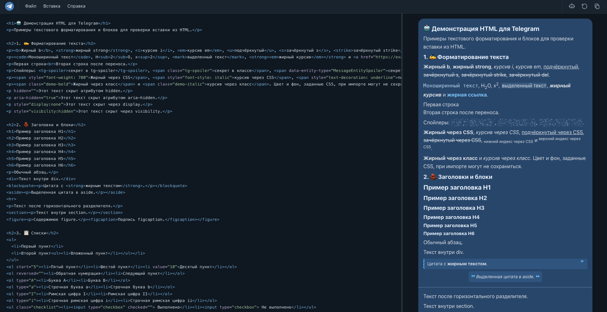

<h1 align="center">✈️ Telemark</h1>

<p align="center">
  HTML-редактор с предпросмотром оформленных постов для Telegram
</p>

<p align="center">
  
  
  
  
</p>

<p align="center">
  <a href="https://vo0ov.github.io/telemark/"><strong>🚀 Открыть Telemark</strong></a>
</p>

---

## 📖 О проекте

**Telemark** помогает подготовить HTML-пост и посмотреть, как он может выглядеть в Telegram. Редактируйте разметку, проверяйте её в предпросмотре и копируйте сообщение специальной кнопкой для вставки в поддерживаемый редактор Telegram Desktop.

Предпросмотр приближён к Telegram: фактический результат зависит от версии и типа редактора. Сам Telemark не публикует сообщения.

---

## 🖼️ Как выглядит Telemark

Редактор HTML и предпросмотр сообщения находятся рядом:

<p align="center">
  
</p>

---

## ⚡ Возможности

- **HTML-редактор:** подсветка разметки, вставка заготовок через меню и отмена действий редактора.
- **Предпросмотр:** форматирование, списки, таблицы, цитаты, раскрывающиеся блоки, спойлеры, код, формулы и медиа.
- **Копирование:** сообщение передаётся в буфер как `text/html` с текстовой версией.
- **Файлы:** открытие и сохранение HTML, восстановление демонстрации, живой предпросмотр локального файла после его сохранения в другом редакторе.
- **Настройки:** размер шрифта, положение разделителя, автосохранение текста в браузере.
- **Обучение и промпт:** подсказки по интерфейсу и Markdown-промпт для подготовки HTML с помощью ИИ.
- **Мобильная версия:** вкладки редактора и предпросмотра для подготовки поста на телефоне.

---

## 🚀 Как пользоваться

1. Откройте Telemark на GitHub Pages или запустите его локально.
2. Напишите HTML в редакторе или добавьте элементы через меню **«Вставка»**.
3. Проверьте сообщение в предпросмотре.
4. Нажмите кнопку копирования в шапке и вставьте сообщение в поддерживаемый редактор Telegram Desktop.
5. Проверьте результат в Telegram перед отправкой.

Для работы на телефоне можно подготовить и сохранить HTML, затем перенести файл на компьютер. Поддержка вставки форматированного HTML в мобильном Telegram может отличаться.

### 👁️ Живой предпросмотр файла

Выберите **«Файл → Открыть файл для предпросмотра…»** и укажите HTML-файл. Telemark будет перечитывать его примерно каждые 250 мс; сохранённые изменения из VS Code или другого редактора появятся в предпросмотре. Кнопка **«Вернуться в редактор»** завершает просмотр и возвращает прежний текст. Для режима необходим HTTPS или `localhost` и браузер с поддержкой File System Access API, например Chrome или Edge. Если файл перемещён, удалён или доступ потерян, откройте его заново. После перезагрузки страницы файл нужно выбрать снова.

### 💻 Локальный запуск

Склонируйте репозиторий и запустите простой HTTP-сервер:

```bash
git clone https://github.com/vo0ov/telemark.git
cd telemark
python3 -m http.server 8000
```

Откройте `http://localhost:8000`. Для доступа к буферу обмена браузеру может потребоваться разрешение; API буфера обмена работает в защищённом контексте, например на `localhost` или HTTPS.

---

## ⚠️ Особенности

- Telegram преобразует HTML в собственные блоки и не выполняет скрипты страницы. Поддержка отдельных тегов зависит от клиента и редактора.
- Внешний вид предпросмотра и реального сообщения может отличаться. Формулы, таблицы, карты, раскрывающиеся блоки и медиа стоит проверять после вставки.
- Изображение по HTTP-ссылке может не импортироваться. Встроенные данные изображения тоже требуют проверки в целевом редакторе.
- Текст и настройки хранятся в `localStorage` текущего браузера и не синхронизируются между устройствами. Очистка данных браузера может их удалить.
- KaTeX загружается с jsDelivr; карта использует OpenStreetMap. Для них нужно подключение к интернету и обращения к сторонним сервисам. Демо включает встроенную фотографию с Unsplash.
- Вставка произвольного HTML предназначена для предпросмотра, а не для запуска скриптов; не используйте Telemark как средство проверки безопасности HTML.

---

## 🏛 Структура проекта

```text
├── index.html                 # Редактор и предпросмотр для GitHub Pages
├── README.md                  # Описание проекта и запуск
├── LICENSE                    # Лицензия MIT
├── CONTRIBUTING.md            # Участие в разработке
├── assets/screenshots/        # Скриншоты интерфейса
└── .github/
    ├── ISSUE_TEMPLATE/        # Шаблоны ошибок и предложений
    └── pull_request_template.md
```

---

## 🤝 Участие в разработке

Сообщайте об ошибках и предлагайте улучшения через Issues. Перед отправкой изменений ознакомьтесь с [CONTRIBUTING.md](CONTRIBUTING.md).

## 📄 Лицензия

Код проекта распространяется по [лицензии MIT](LICENSE). Сторонние библиотеки, карта и фотография используются на собственных условиях их правообладателей.

---

<p align="center">Сделано с ❤️ для создания постов в Telegram</p>
